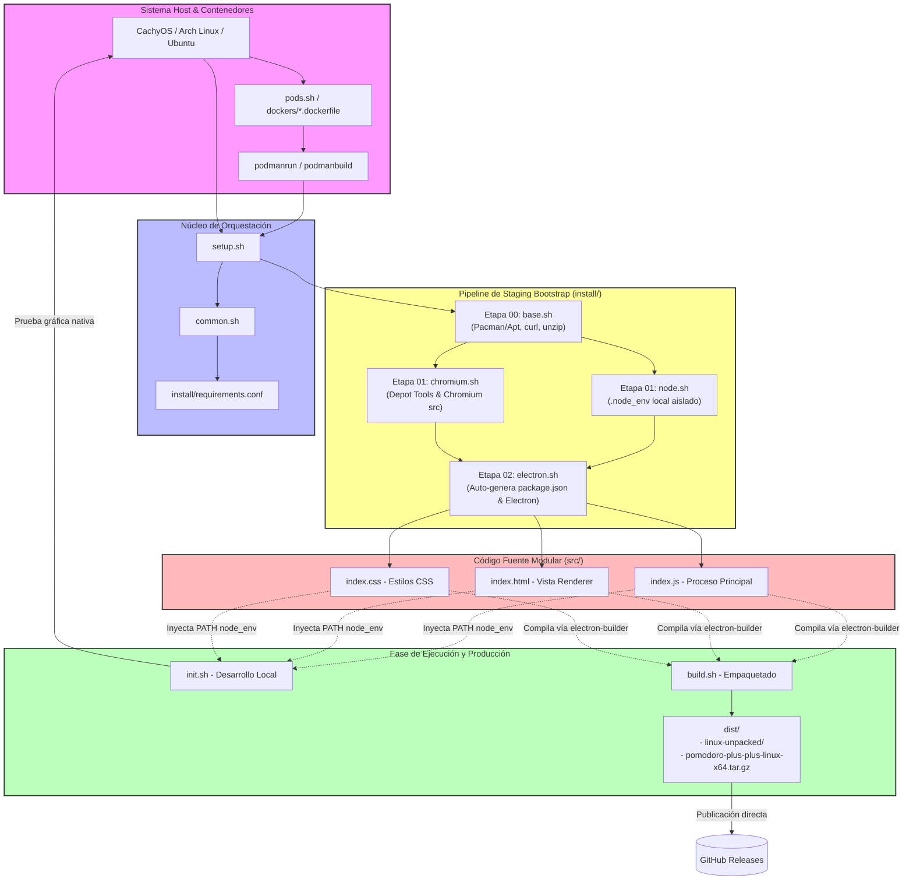

# Pomodoro Plus Plus

Aplicación de escritorio modular basada en Electron para la gestión del tiempo y productividad, diseñada con un entorno de desarrollo portable y automatizado para Linux.

## Sistemas Operativos Compatibles (Linux)

El framework de staging bootstrap soporta nativamente las siguientes distribuciones:

* **Arch Linux**
* **Ubuntu**

---

## 1. Instalación y Staging Bootstrap (Configuración y Dependencias)

Para desplegar y configurar todo el proyecto desde cero utilizando exclusivamente el conjunto de scripts de orquestación:

1. **Clonar el repositorio**:
```bash
git clone https://github.com/CarlosConLetraC/pomodoro-plus-plus.git
cd pomodoro-plus-plus
```

2. **Iniciar contenedor con podman**
Se recomienda utilizar podman para evitar instalar dependencias temporales en su sistema principal. Para ello se debe instalar podman en caso de no tenerlo en el sistema.

* Arch Linux (o derivados):
```bash
sudo pacman -S podman --noconfirm
```

* Debian (o derivados):
```bash
sudo apt-get update
sudo apt install -y podman
```

Una vez hecho esto, configure los contenedores podman mediante el siguiente comando:
```bash
./pods.sh dockerfile/<contenedor deseado>.dockerfile

```

Si desea configurar TODOS los contenedores predefinidos. Simplemente haga:
```bash
./pods.sh
```

Hecho lo anterio, inicie el contenedor podman utilizando el siguiente commando:
```bash
source common.sh
podmanrun podman_<contenedor deseado>
# <contenedor deseado>: distribución linux deseada (actualmente únicamente se puede modular mediante cachyos).
# Por lo que necesita ejecutar: podmanrun podman_cachyos
```

3. **Ejecutar el orquestador principal (`setup.sh`)**:
Este script detecta tu distribución compatible, lee los parámetros globales desde `install/requirements.conf`, configura las herramientas del sistema operativo mediante `pacman`|`apt`, instala Node.js de forma aislada en `.node_env`, descarga los binarios de Electron y prepara las dependencias de empaquetado.
```bash
# NOTA: asegurar estar dentro del contenedor podman antes de ejecutar el setup.
./setup.sh
```

---

## 2. Desarrollo Local y Pruebas (`init.sh`)

*Nota importante:* El script `init.sh` **no** realiza tareas de instalación ni compilación. Únicamente se utiliza una vez que el proyecto ya se encuentra configurado para levantar la aplicación en modo de desarrollo local, inyectando las rutas del `PATH` y ejecutando Electron directamente sobre los fuentes modulares de `src/`.

Para probar la aplicación en tu entorno gráfico:
```bash
./init.sh
```

---

## 3. Compilación del Entregable Final (`build.sh`)

Una vez realizadas las pruebas necesarias, para empaquetar la aplicación en un formato portable autónomo (sin dependencias de FUSE) listo para producción y GitHub Releases:
```bash
./build.sh
```
Esto generará la estructura compilada y el paquete comprimido final dentro de la carpeta `dist/`.

---

## 4. Descripción Detallada de cada Script (`.sh`)

* **`setup.sh`**: Orquestador principal del bootstrap. Detecta el sistema operativo del host, resuelve el directorio de etapas correspondiente y ejecuta secuencialmente los scripts numéricos de configuración.


* **`init.sh`**: Lanzador de pruebas y desarrollo local. Carga el entorno aislado de Node (`.node_env/bin`) e inicia la aplicación Electron apuntando a los archivos fuente modulares, requiriendo que el proyecto haya sido previamente inicializado.


* **`build.sh`**: Script de compilación y empaquetado. Utiliza `electron-builder` para generar la distribución portable (`dir`) y empaqueta el resultado en un archivo `.tar.gz` optimizado.
* **`common.sh`**: Librería central de funciones compartidas. Proporciona registro con marcas de tiempo (`prettyprint`), detección automática del sistema operativo (`get_os_version`), resolución de rutas y utilidades para contenedores Podman (`podmanbuild`, `podmanrun`).


* **`pods.sh`**: Utilidad de contenedores. Limpia contenedores detenidos y reconstruye de manera limpia todas las imágenes de Podman a partir de los archivos `.dockerfile` ubicados en `dockers/`.

## 4.1. Staging Bootstrap

* **`install/<OS>/<VERSION>/00/base.sh`**: Script de la etapa inicial. Configura los parámetros de `pacman.conf` para entornos rootless y asegura la instalación de herramientas compartidas esenciales como `unzip` y `curl`.
* **`install/<OS>/<VERSION>/01/chromium.sh`**: Descarga chromium y lo compila desde código fuente (versión específica en `install/requirements.conf`).
* **`install/<OS>/<VERSION>/01/node.sh`**: Descarga nodejs, npm y npx y configura dependencias temporalmente (versión específica en `install/requirements.conf`)
* **`install/<OS>/<VERSION>/02/electron.sh`**: Script de la etapa de Electron. Instala las dependencias gráficas necesarias mediante `pacman`, aprovisiona Electron localmente, valida de forma estricta la estructura modular en `src/` (`index.js`, `index.html`, etc.) y configura `electron-builder`.

# 5 Arquitectura Detallada del Sistema
#### 1. Estructura de Árbol de Archivos (File Tree Hierarchy)
```
pomodoro-plus-plus/
├── setup.sh                     # Entrypoint de orquestación de staging bootstrap
├── init.sh                      # Lanzador de entorno de desarrollo local (requiere setup previo)
├── build.sh                     # Pipeline de empaquetado y distribución portable
├── common.sh                    # Librería de funciones globales, utilidades de OS y Podman
├── pods.sh                     # Gestor de compilación e imágenes de Podman
├── install/
│   ├── requirements.conf        # Configuración centralizada de versiones (Node, Electron, Chromium)
│   ├── archlinux/rolling/       # Pipeline de etapas para Arch Linux
│   │   ├── 00/base.sh           # Configuración de pacman y herramientas base
│   │   ├── 01/node.sh           # Aprovisionamiento local de Node.js runtime (.node_env)
│   │   ├── 01/chromium.sh       # Preparación de dependencias/fuentes de Chromium
│   │   └── 02/electron.sh       # Auto-generación de package.json, Electron y electron-builder
│   ├── cachyos/rolling/         # Pipeline de etapas para CachyOS (idéntico a Arch Linux)
│   │   ├── 00/base.sh
│   │   ├── 01/node.sh
│   │   ├── 01/chromium.sh
│   │   └── 02/electron.sh
│   └── ubuntu/22.04/            # Pipeline de etapas para Ubuntu
│       ├── 00/base.sh           # Configuración base de apt
│       ├── 01/node.sh
│       ├── 01/chromium.sh
│       └── 02/electron.sh
├── dockers/                     # Entornos de prueba aislados en contenedores
│   ├── archlinux.dockerfile
│   ├── cachyos.dockerfile
│   └── ubuntu_22.04.dockerfile
└── src/                         # Código fuente modular de la aplicación
    ├── index.js                 # Proceso principal (Main Process - Electron)
    ├── index.html               # Proceso de renderizado (Renderer View)
    └── index.css                # Hoja de estilos del Renderer
```

#### 2. Flujo de Ejecución y Dependencias de Componentes
```
+-----------------------------------------------------------------------------------+
|                                  SISTEMA HOST                                     |
|  (CachyOS / Arch Linux / Ubuntu / Contenedor Podman activado mediante pods.sh)    |
+-----------------------------------------------------------------------------------+
                                          |
                                          v
                              +-----------------------+
                              |       setup.sh        |
                              +-----------------------+
                                          |
                                          v  (Carga dependencias e inspecciona OS)
                              +-----------------------+
                              |       common.sh       |
                              +-----------------------+
                                          |
                                          v  (Lee configuraciones globales)
                              +-----------------------+
                              |   requirements.conf   |
                              +-----------------------+
                                          |
                +-------------------------+-------------------------+
                |                         |                         |
                v                         v                         v
       [install/cachyos/]        [install/archlinux/]       [install/ubuntu/]
                |                         |                         |
                +-------------------------+-------------------------+
                                          |
                                          v
      +------------------------------------------------------------------------+
      |                      EJECUCIÓN POR ETAPAS (STAGING)                    |
      |                                                                        |
      |  +------------------------------------------------------------------+  |
      |  | Etapa 00: base.sh                                                |  |
      |  | - Sincroniza gestores de paquetes (pacman / apt).                |  |
      |  | - Instala dependencias base (curl, unzip, etc.).                 |  |
      |  +------------------------------------------------------------------+  |
      |                                   |                                    |
      |                                   v                                    |
      |  +------------------------------------------------------------------+  |
      |  | Etapa 01: node.sh                                                |  |
      |  | - Descarga e instala Node.js aislado en .node_env/ (estilo .venv)|  |
      |  | Etapa 01: chromium.sh                                            |  |
      |  | - Prepara herramientas/dependencias de compilación para Chromium |  |
      |  +------------------------------------------------------------------+  |
      |                                   |                                    |
      |                                   v                                    |
      |  +------------------------------------------------------------------+  |
      |  | Etapa 02: electron.sh                                            |  |
      |  | - Auto-genera package.json con scripts y campos de build         |  |
      |  | - Instala Electron y electron-builder localmente                 |  |
      |  | - Valida integridad de archivos requeridos en src/               |  |
      |  +------------------------------------------------------------------+  |
      +------------------------------------------------------------------------+
                                          |
                        +-----------------+-----------------+
                        |                                   |
                        v                                   v
             [Desarrollo / Pruebas]                 [Compilación Final]
                        |                                   |
                        v                                   v
             +--------------------+               +-------------------+
             |      init.sh       |               |     build.sh      |
             +--------------------+               +-------------------+
                        |                                   |
                        v                                   v
             Inyecta .node_env/bin en PATH       Ejecuta electron-builder --linux dir
             y arranca Electron sobre src/       Genera dist/linux-unpacked/
                                                            |
                                                            v
                                                  Comprime artefacto en:
                                                  dist/pomodoro-plus-plus-linux-x64.tar.gz
```

#### 3. Descripción de Módulos y Arquitectura Técnica
##### 1. **Orquestación de Staging Automático (`setup.sh`, `common.sh`, `install/`)**:
* **Detección Dinámica del SO**: `common.sh` lee `/etc/os-release` mediante la función `get_os_version()` y resuelve automáticamente la ruta de ejecución según la distribución (`install/{id}/{version}/{stage}`).

* **Aislamiento de Dependencias**: Node.js se descarga en formato binario y se desempaqueta en el directorio local `.node_env/`, garantizando cero contaminación global de paquetes en el sistema host.

* **Aprovisionamiento Autónomo**: `electron.sh` comprueba la existencia de `package.json`. Si el repositorio se clona limpio, genera automáticamente el manifiesto base con los scripts de ejecución y las directivas de compilación de `electron-builder`.


##### 2. **Capa de Aplicación y Fuentes (`src/`)**:
* **Main Process**: `src/index.js` actúa como el proceso principal que gestiona el ciclo de vida de las ventanas y eventos del sistema en Electron.

* **Renderer View**: `src/index.html` e `src/index.css` conforman el proceso de renderizado visual de la interfaz de usuario.


##### 3. **Entorno de Pruebas en Contenedores (`pods.sh`, `dockers/`)**:
* **Pruebas Multi-Distribución**: Permite compilar y validar la instalación en imágenes Podman aisladas (`cachyos.dockerfile`, `archlinux.dockerfile`, `ubuntu_22.04.dockerfile`).

* **Aislamiento Rootless**: Mantiene el montaje transparente del espacio de trabajo del usuario mediante utilidades `podmanrun` y `podmanbuild`.


##### 4. **Pipeline de Despliegue y Distribución (`build.sh`)**:
* Genera una compilación portable descomprimida (`dist/linux-unpacked/`) que no requiere librerías de compatibilidad obsoletas de FUSE (`libfuse.so.2`).

* Empaqueta el ejecutable final y sus recursos en un archivo `.tar.gz` listo para ser distribuido en GitHub Releases.

---

## 6. Diagrama de Arquitectura Global del Sistema (Mermaid)

El siguiente diagrama detalla de forma exhaustiva las interrelaciones entre el sistema host, los contenedores Podman, el pipeline de staging bootstrap por etapas, los scripts de ejecución y el empaquetado final:

