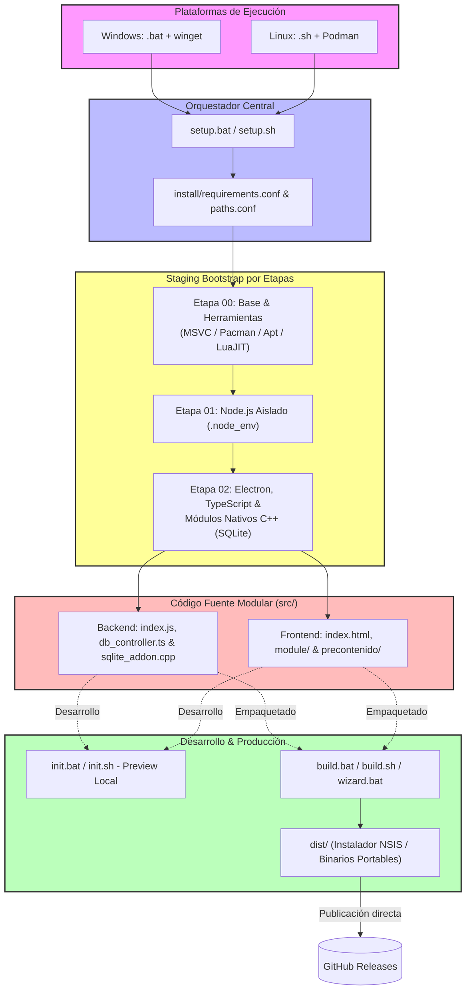

# Pomodoro Plus Plus

Aplicación de escritorio modular basada en Electron para la gestión del tiempo y productividad, diseñada con un entorno de desarrollo portable y automatizado tanto para **Linux** como para **Windows**.

## Sistemas Operativos Compatibles

El framework de staging bootstrap soporta nativamente las siguientes plataformas:

* **Windows** (vía scripts `.bat` y aprovisionamiento automático con `winget`)
* **Arch Linux** / **CachyOS**
* **Ubuntu**
* **Debian**

---

## 1. Instalación y Staging Bootstrap (Configuración y Dependencias)

Para desplegar y configurar todo el proyecto desde cero utilizando el conjunto de scripts de orquestación:

### En Windows:
1. **Clonar el repositorio**:
```cmd
git clone https://github.com/CarlosConLetraC/pomodoro-plus-plus.git
cd pomodoro-plus-plus
```

2. **Ejecutar el orquestador principal (`setup.bat`)**:
Este script detecta los requisitos del sistema, instala o verifica herramientas base de compilación en segundo plano (como Python y MSVC Build Tools mediante `winget`), despliega un entorno Node.js aislado localmente en `.node_env`, instala Electron, TypeScript y compila los módulos nativos (`sqlite_native.node`).
```cmd
setup.bat
```

### En Linux (Entorno Host o Podman):
1. **Clonar el repositorio**:
```bash
git clone https://github.com/CarlosConLetraC/pomodoro-plus-plus.git
cd pomodoro-plus-plus
```

2. **Iniciar contenedor con Podman (Opcional / Recomendado)**:
Se recomienda utilizar Podman para evitar instalar dependencias temporales en su sistema principal.

* Arch Linux / CachyOS:
```bash
sudo pacman -S podman --noconfirm
```

* Debian / Ubuntu:
```bash
sudo apt-get update && sudo apt install -y podman
```

Configurar e iniciar el contenedor:
```bash
./pods.sh
source common.sh
podmanrun podman_cachyos
```

3. **Ejecutar el orquestador principal (`setup.sh`)**:
Detecta la distribución compatible, lee los parámetros desde `install/requirements.conf`, configura las herramientas del sistema operativo, instala Node.js de forma aislada en `.node_env`, descarga Electron y compila dependencias nativas (SQLite y LuaJIT).
```bash
./setup.sh
```

---

## 2. Desarrollo Local y Pruebas (`init`)

*Nota importante:* El comando `init` (**`init.bat`** en Windows o **`init.sh`** en Linux) compila automáticamente las fuentes de TypeScript del backend y lanza la aplicación en modo de desarrollo local sobre los fuentes modulares de `src/`.

Para probar la aplicación en tu entorno:
* En Windows:
  ```cmd
  init
  ```
* En Linux:
  ```bash
  ./init.sh
  ```

---

## 3. Compilación del Entregable Final (`build` y `wizard`)

Una vez realizadas las pruebas necesarias, para empaquetar la aplicación en un formato portable autónomo listo para producción y GitHub Releases:

* En Windows (genera el paquete portable y el instalador NSIS):
  ```cmd
  build
  ```
  *(Opcional)* Para generar directamente el instalador interactivo por asistencias (Wizard NSIS):
  ```cmd
  wizard
  ```
* En Linux:
  ```bash
  ./build.sh
  ```
Esto generará la estructura compilada y el paquete final dentro de la carpeta `dist/`.

---

## 4. Descripción Detallada de los Scripts de Orquestación

### Scripts de Windows (`.bat`):
* **`setup.bat`**: Orquestador principal en Windows. Lee las especificaciones de `install/requirements.conf` y ejecuta secuencialmente las etapas de configuración (`base.bat`, `node.bat`, `electron.bat`, `sqlite.bat`).
* **`init.bat`**: Carga el entorno local portable (`.node_env`), valida dependencias, compila TypeScript y arranca Electron para vista previa.
* **`build.bat`**: Ejecuta la compilación de TypeScript y empaqueta el proyecto mediante `electron-builder` generando el instalador para Windows.
* **`wizard.bat`**: Genera el instalador interactivo NSIS optimizado para Windows.

### Scripts de Linux (`.sh`) y Herramientas Auxiliares:
* **`setup.sh`**: Orquestador principal del bootstrap para entornos Unix.
* **`init.sh`**: Lanzador de pruebas y desarrollo local e inyección de variables de ruta para X11/Ozone.
* **`build.sh`**: Script de compilación y empaquetado portable para distribuciones Linux (sin dependencias de FUSE).
* **`common.sh`**: Librería central de funciones compartidas (`prettyprint`, `get_os_version`, utilidades Podman).
* **`pods.sh`**: Utilidad de gestión para limpiar y reconstruir imágenes de Podman a partir de `dockers/`.
* **`install.sh` / `uninstall.sh`**: Scripts de instalación y desinstalación a nivel de sistema.
* **`config_manager.lua` / `json.lua`**: Módulos en LuaJIT para la gestión de configuraciones y serialización JSON.

### 4.1. Staging Bootstrap (`install/`)
* **`install/<OS>/<VERSION>/00/base.(sh|bat)`**: Etapa inicial. Sincroniza gestores de paquetes (`pacman`/`apt`) o configura herramientas base en Windows mediante `winget` (Python 3 y Visual Studio Build Tools C++).
* **`install/<OS>/<VERSION>/00/luajit.sh`**: Aprovisionamiento de LuaJIT en entornos Linux compatibles (CachyOS / Debian).
* **`install/<OS>/<VERSION>/01/node.(sh|bat)`**: Descarga e instala Node.js y npm de forma aislada en `.node_env`.
* **`install/<OS>/<VERSION>/02/electron.(sh|bat)`**: Auto-genera `package.json`, valida la estructura modular en `src/` e instala Electron, `electron-builder` y TypeScript.
* **`install/<OS>/<VERSION>/02/sqlite.(sh|bat)`**: Descarga el código fuente de SQLite y compila el addon nativo en C++ (`sqlite_native.node`) mediante `node-gyp`.

---

## 5. Arquitectura Detallada del Sistema

### 1. Estructura de Árbol de Archivos
```text
pomodoro-plus-plus/
├── build.bat / build.sh         # Pipelines de empaquetado final
├── init.bat / init.sh           # Lanzadores de desarrollo local (Preview)
├── setup.bat / setup.sh         # Orquestadores de staging bootstrap
├── wizard.bat                   # Generador de instalador NSIS (Windows)
├── install.sh / uninstall.sh    # Scripts de instalación en sistema
├── common.sh                    # Librería compartida de funciones core
├── pods.sh                      # Gestor de contenedores Podman
├── config_manager.lua           # Gestor de configuración en Lua
├── json.lua                     # Parser/serializador JSON en Lua
├── install.conf                 # Configuración general de instalación
├── dockers/                     # Entornos de prueba aislados en contenedores
│   ├── archlinux.dockerfile
│   ├── cachyos.dockerfile
│   ├── debian13.dockerfile
│   └── ubuntu_22.04.dockerfile
├── install/
│   ├── paths.conf               # Definición de rutas del proyecto
│   ├── requirements.conf        # Versiones globales (Node, Electron, SQLite)
│   ├── windows/rolling/         # Etapas de aprovisionamiento en Windows (.bat)
│   │   ├── 00/base.bat
│   │   ├── 01/node.bat
│   │   └── 02/{electron.bat, sqlite.bat}
│   ├── archlinux/rolling/       # Etapas para Arch Linux (.sh)
│   ├── cachyos/rolling/         # Etapas para CachyOS (.sh)
│   ├── debian/13/               # Etapas para Debian 13 (.sh)
│   └── ubuntu/22.04/            # Etapas para Ubuntu 22.04 (.sh)
└── src/                         # Código fuente modular de la aplicación
    ├── backend/                 # Proceso principal, TypeScript y addons nativos
    │   ├── db_controller.ts
    │   ├── ignoreKeybinds.js
    │   ├── index.js
    │   ├── tsconfig.json
    │   └── native/              # Addon C++ para SQLite
    │       ├── binding.gyp
    │       └── sqlite_addon.cpp
    └── frontend/                # Interfaz visual (Renderer View)
        ├── assets/icon.png
        ├── index.css
        ├── index.html
        ├── module/              # Lógica modular JS (common, inicio, navigation, topbar, configuraciones)
        └── precontenido/        # Vistas parciales HTML/CSS (inicio, estadisticas, configuraciones, popup, topbar)
```

### 2. Descripción de Módulos Técnicos
1. **Orquestación Multiplataforma (`setup.bat` / `setup.sh`)**:
   * **Aislamiento Total**: Node.js se despliega en `.node_env/` sin alterar instalaciones globales del sistema.
   * **Aprovisionamiento Autónomo**: Genera dinámicamente `package.json` y compila código nativo en C++ (`sqlite_addon.cpp`) usando MSVC en Windows o GCC/Clang en Linux.
2. **Capa de Backend (`src/backend/`)**:
   * **Main Process**: `index.js` e `ignoreKeybinds.js` gestionan las ventanas y atajos del sistema en Electron.
   * **Persistencia Nativa**: `db_controller.ts` se comunica con el módulo nativo `sqlite_native.node` compilado mediante `node-gyp`.
3. **Capa de Frontend (`src/frontend/`)**:
   * Arquitectura modular basada en vistas parciales (`precontenido/`) y controladores independientes (`module/`) renderizados sobre `index.html`.

---

## 6. Diagrama de Arquitectura Global del Sistema (Mermaid)

